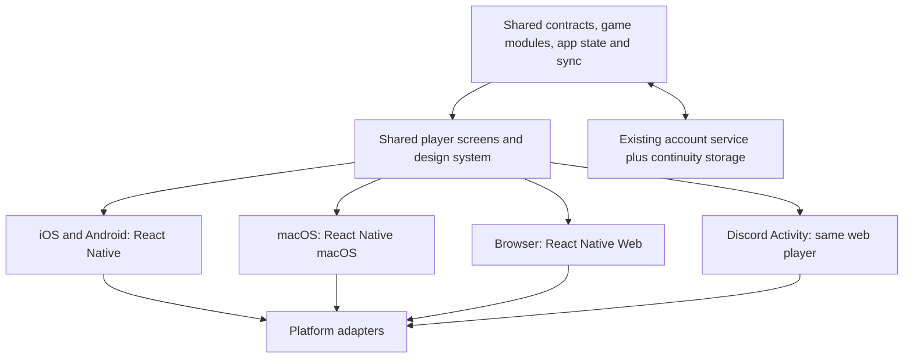

# *doku: one product across native, web, and Discord

Architecture revision: **October 8, 2026**. The owner prioritizes seamless experience, all themes/options, preservation of accounts/history/friends, full device integration, and sustainable solo maintenance over implementation speed. There is no fixed deadline. This supersedes October 7's open RN/Tauri comparison and deferral of active-game sync. This document is a proposed implementation plan: no native project, migration, production account change, build pipeline, signing setup, or store submission has been performed.

## Direction and acceptance contract

Target **React Native for iOS/Android, React Native macOS, and React Native for Web for the browser/Discord player UI**, with a shared TypeScript core and the existing account service. The website's marketing/legal content may remain ordinary React DOM. Discord remains a web Activity using its SDK adapter; it consumes the same player screens/core as the browser. RN Web renders compatible RN code through React DOM and can be adopted incrementally. [RN Web introduction](https://necolas.github.io/react-native-web/docs/), [Discord Activities](https://docs.discord.com/developers/activities/overview).

This is the recommended engineering direction for the owner's priorities, subject to the compatibility gate below. Tauri/Capacitor remain documented alternatives from the earlier comparison, not parallel production apps or an automatic fallback. If a material RN limitation prevents the agreed experience, bring back a concrete decision with evidence rather than quietly changing the architecture.

The promise to implement is **one product and one maintained source for its shared behavior/UI**, with platform-specific integrations. Separate native binaries, project files, adapters, and verification remain necessary. Shared source does not make native menus, browser accessibility, safe areas, secure storage, auth, or store signing identical. RN explicitly supports platform-specific modules/components. [Platform-specific code](https://reactnative.dev/docs/platform-specific-code).

Acceptance is observable:

1. Sign in to the same *doku identity from phone, Mac, browser, and Discord; retain the same profile, friends/requests, privacy choices, achievements, and history. Provider selection must not accidentally create a second identity.
2. Resume the same unfinished puzzle, values, notes, undo/assistance state, and accumulated active time on another signed-in surface after its changes synchronize. Completed history includes detail/results, not only a score summary. No silent loss if two devices edit offline.
3. Keep all twelve themes, all three current variants and difficulty levels, input modes, number/note/font settings, and the five result displays. Platform interaction adapts; feature parity and theme identity remain.
4. Play and save offline. Accountless guest play remains available; cross-device continuity needs an account or deliberate data transfer. An offline device cannot see changes another device has not synchronized yet.
5. Add a theme, a game rule change, or a shared feature in its owning shared module. Build all affected targets automatically from that revision. Platform-specific new capabilities may still need one adapter implementation per supported target.
6. An existing user upgrades/migrates without losing account ID, friends, local saves or records. Unsynced browser/Discord data requires an explicit safe import; it is not automatically available inside an installed app's sandbox.

## Shared code and platform boundaries

Proposed paths below are relative to the **repository root**. They are boundaries to introduce incrementally, not directories already created. Use the existing npm workflow with npm workspaces initially; there is no demonstrated need for a second package manager or a large build-orchestration framework.

| Shared owner/path | Contents and invariant |
| --- | --- |
| `packages/contracts/` | Versioned wire/storage envelopes, IDs, sync operations, validation, and game module contracts. Used by clients and server; no browser/RN globals |
| `packages/core/` | Player/application controllers, API client, sync coordinator/outbox, hydration/account ownership, settings policy, active clock, navigation intents. No rendering or direct storage/OS calls |
| `packages/games/sudoku/` | Current engine/session/selection/daily/scoring/records/awards rules, preserving existing fixtures/seeds. Exports pure rules and game-specific codecs; never imports UI or platform services |
| `packages/design/` | One theme catalog with semantic foreground/surface pairs, typography, assets, shapes, state recipes, jigsaw region fills, and motion intent. Generates legacy/marketing CSS tokens during migration; shared UI reads the same definitions |
| `packages/ui/` | Shared RN player screens, controls, result displays, accessibility semantics, theme treatments and game presentation under `games/sudoku/`. UI emits core actions and consumes state; no duplicate game/account/sync rules |
| `packages/platform/` | Ports and `.web`, `.ios`, `.android`, `.macos`, and Discord compositions for storage, credentials, HTTP configuration, lifecycle, links, share/export, haptics, keyboard/window/navigation integration. Native bridge project code stays in its app |
| `apps/mobile/` | Thin iOS/Android entry, registered native modules, manifests/entitlements/assets, native projects and build configuration; imports shared packages |
| `apps/macos/` | Thin RN macOS entry, native project, menu/window/credential/file/share bridges; imports the same shared packages |
| Existing `app/` | Browser/Discord entry and marketing, existing `server/`, tests, and protected device preview. Adopt the shared player incrementally; avoid moving every directory in the first slice |

Keep modules inside these packages until their boundaries justify splitting. Do not create a package for every component. Enforce dependency direction and browser-global restrictions in core/rules so future features cannot slowly pull OS logic back into shared rules.

The end state shares **player screens as well as rules**. Keeping the old React DOM player and a new native player forever would still duplicate features and theme treatments. During migration both exist briefly for side-by-side parity; retire each old player screen after the replacement passes its gate. Marketing and OS chrome are intentionally separate presentation surfaces. Preserve `app/src/App.tsx`, `main.tsx`, `styles.css`, `src/mobile/`, calibrated device assets and build/runtime contracts under `app/AGENTS.md`; native apps do not ship the simulated phone frame.

## Theme portability and device cooperation

All current IDs remain: `retro`, `comic`, `comic-dark`, `doodle`, `glass`, `rounded`, `rounded-dark`, `night`, `paper`, `blackboard`, `contrast`, `plum`. Native views cannot consume the current CSS files unchanged. Port the existing visual language once into shared tokens, drawing geometry and themed RN components; then use those components through RN Web too. Preserve expressive anatomy: Comic bursts, Web 2.0 bevels/sectors, Doodle ink, Glass panes, hue motifs, jigsaw bands/borders, and readable selection/error/pencil states. Do not reduce the themes to palette swaps.

Use common geometry/assets for custom board decoration and a narrowly selected drawing renderer. Prove its gradients, fonts, SVG/path support and performance on Mac as well as phones/web before standardizing it. Rendering data can be shared even where a drawing primitive needs a platform implementation. A canvas/SVG board alone is not sufficient accessibility: interactive cells need meaningful native/DOM accessibility targets and keyboard behavior. Imported CSS, browser pseudo-elements/filters, and off-the-shelf web dialogs need deliberate ports.

Theme work has one catalog and one component treatment, with a generated state gallery and regression matrix. A new theme must implement required states rather than supply only colors. Generate platform styles from canonical definitions where appropriate; do not promise an automatic CSS-to-native conversion. Existing `app/docs/STYLE-AUDIT.md` is the baseline for the port, not native rendering proof.

| Surface | Convenience provided by its adapter/shell |
| --- | --- |
| iPhone/iPad | Real safe areas/status bars, touch and accessibility, OS auth/share, optional haptics, lifecycle saves, tablets/split view |
| Android | System Back/predictive-back compatibility, gesture navigation, keyboard insets, credential manager, native share and background handling |
| macOS | Resizable board-first window, keyboard/trackpad, focus-aware Cmd shortcuts, real menus, native open/save/share, window lifecycle and sandbox file access |
| Browser | URLs, keyboard/focus, DOM semantics, browser auth/download/share fallback, responsive layout, existing canonical links |
| Discord | Activity SDK authentication/share, proxy/API routing, platform/layout/safe-area signals, same account/core/player; no Discord requirement outside the Activity |

Native game screens use *doku's themed UI while system menus/auth/share follow platform conventions. Device-local preferences such as window size, haptics availability and OS accessibility overrides stay local; portable preferences such as theme, input order, result views and number typography synchronize. An OS accessibility setting wins over a synced preference when necessary. No settings claim a capability the current host cannot provide.

## Continuity: preserve identity and add the missing data layer

Fresh source inspection shows a useful foundation, not complete continuity:

| Current code | What exists | Work required |
| --- | --- | --- |
| `app/server/auth.ts`, `account.ts`, `social.ts` | One backend user ID, provider accounts, profiles, friendships/requests, bearer/cookie sessions and completed-record storage | Retain IDs/relationships and extend contracts/migrations. Native login/callbacks and provider linking still need proof |
| `app/src/game/account.ts:syncRecords`, `server/account.ts:/me/records` | Merge completed `PlayRecord` summaries by ID | Full history/session/settings sync, incremental pulls/acks, transactional idempotency, reconnect/focus behavior |
| `app/src/Prototype.tsx` | History/detail uses local `Session[]`; active/parked sessions, settings, records and names use browser-wide local keys | Extract controllers, account-scoped storage and complete migration. A synced summary cannot reconstruct detailed history |
| `app/src/game/engine.ts`, `daily.ts`, `records.ts` | Deterministic seeds and current Sudoku payloads | Generator/rules/schema versions for rolling web/native releases; stable puzzle descriptors |
| `app/server/account.ts:/me/export` | Server profile plus completed records | Versioned local export of full browser history, sessions/settings/parked saves, with private credentials removed |
| `app/server/app.ts:/challenges/:id/attempts`, `app/src/game/session.ts` | Private token authorizes an attempt; no account owner is stored on the server attempt | Authenticated attempt ownership, safe legacy claim, and credential recovery before cross-device continuation |
| `.github/workflows/ci.yml` | Ubuntu web typecheck/tests/build and runtime integrity | Reproducible Android/iOS/Mac builds, cross-platform verification, controlled signing and release gates |

**Account identity.** Reuse the existing service and `userId`; native apps must not introduce separate Apple/Google/Discord player accounts. Device credentials differ, the player ID does not. Authenticate through the appropriate platform flow and securely exchange/store sessions. The existing code can link a verified provider email or create a synthetic Discord email; Apple private relay, missing Discord email, and different email addresses can produce separate identities. Add authenticated provider linking/recovery and a deliberate, tested duplicate-account merge flow preserving histories and relationships. Never infer ownership solely from a display name or arbitrary client email. Audit existing linking rules and prove native/web/Discord login to the same identity before claiming it.

**Canonical data.** Introduce owned entities for completed-game detail, active/parked sessions, portable preferences, and immutable completion summaries. Keep profile/friends authoritative on the existing service, with bounded local caches. Preserve session/attempt IDs across handoff so one resumed completion is not scored twice. Achievements and scores are derived from appropriate game records/rules, not independently rewritten by each shell. Keep assistance provenance and any server verification classification; synced client saves do not establish trusted competitive scores.

**Challenge attempt ownership.** Existing attempts are token-authorized, not account-owned. Add a transactional, repeat-safe legacy claim that requires both an authenticated account and the valid existing attempt credential, binds one owner, and allows secure credential reissue or account-authorized continuation. Never infer ownership from a puzzle seed, display name or mere knowledge of an attempt ID. Keep guest attempts playable locally. Claim eligible attempts before authenticated cross-device migration; exports and shared links still redact attempt secrets. If an imported/unclaimed attempt lacks its credential, preserve the local save/history and explain recovery or a new attempt rather than claiming its submission capability transferred. Test duplicate claim, wrong-owner access, credential revocation and account switching.

**Storage ownership.** Namespace local saves/outbox/cache by backend account ID and a distinct guest identity. Current browser-wide records can otherwise be uploaded under the next signed-in account. On account switch, cancel old requests, swap namespaces atomically, and reject responses carrying the wrong owner/generation. Never automatically upload a prior account's saves. Offer an explicit claim/merge of guest progress, with a backup and repeat-safe operation. An expired credential while offline does not make the last known owner's saves become guest data. Logout/deletion policy must explain local retention and preserve intentional recovery without exposing data to another account.

**Sync protocol.** Define a versioned API, durable local outbox, idempotent operation IDs, per-entity revisions, incremental cursor/pagination, explicit per-operation acknowledgments/rejections, and deletion tombstones. Local writes commit before network work; server pushes use authenticated ownership and transactional upserts/uniqueness. Current read-existing/insert-individually record sync can race or partially commit and returns a full list; it is not the final scalable protocol. Pull on sign-in, foreground, reconnect and explicit refresh; push queued actions with bounded retries/backoff. Real-time notifications can trigger pulls while active, but mobile suspension requires resumption reconciliation regardless. A low-noise sync indicator communicates pending/offline/recovery state without blocking play or promising instantaneous offline handoff.

**Conflicts and active time.** Use session-level revision checks and an active-writer lease for ordinary online handoff. The lease cannot prevent offline edits or force-quit races. Default an older open client to a clear takeover flow when another surface is writing; preserve conflicting offline branches and offer a choice/copy. Never merge cell arrays or add timers from both branches. A session snapshot includes notes, undo/redo, assistance/events, completion state, puzzle descriptor/version and accumulated active time. Use monotonic clock segments and platform lifecycle; retain hidden-timer behavior. The current browser clock only gates on visible game/document, not every dialog, so interruption pause policy needs explicit definition. Test background/lock/sleep, first tick after suspension, Mac focus, duplicate completion and crash during persistence/sync.

**Puzzle identity across versions.** Add `gameId`, wire/storage `schemaVersion`, rules/generator version, and stable puzzle ID/descriptor before changing generation. A newly deployed website and a store build from last month must not generate different boards for the same daily/challenge identity. Preserve existing seeds/IDs in legacy migration; do not retroactively regenerate historical sessions from an updated algorithm. Retain compatible generation/codecs or canonical givens/regions plus controlled private solving data for offline restoration. Shared links expose only public puzzle/challenge data; never solutions or private attempt/bearer tokens. Unknown newer game/schema versions preserve data and offer an understandable compatible update path rather than silently resetting.

**Daily dates.** Preserve recorded daily/local date keys and completed histories during migration. Active handoff carries the puzzle's assigned date even if the receiving device is in another time zone. If “Today” must always be identical across differently configured devices, select an account-day timezone policy explicitly; do not silently replace the current local-calendar convention with UTC. The current hydration drops older parked dailies; do not apply that destructive cleanup to migrated backups or synced sessions without a chosen retention policy. There is no streak/reset behavior.

## Safe migration and the seamless release gate

Use additive backend/storage changes with a compatibility window while old web/native clients exist. Inventory all browser keys and server entities, take recoverable snapshots, and assign old Sudoku payloads a legacy version without changing IDs, dates, records or friendships. Never overwrite old data simply because a new client hydrates an empty/default state.

Provide a versioned browser/Discord-local export/import or authenticated upload of full owned game data; native cannot read another sandbox's localStorage. Validate schemas, redact auth/provider/attempt secrets, deduplicate stable IDs, preview merge/conflicts, retain the prior snapshot, and make repeated import idempotent. The server export currently cannot substitute for this. Do not claim recovery of data already lost/unavailable in an old browser. Reuse optional account sync for verified existing server records, then hydrate complete new entities when available.

A release claiming seamless account continuity must pass one scenario across all four surfaces:

1. Existing browser account retains its user ID, friends/privacy and completed history/detail after migration; a guest's local progress imports only after their explicit claim.
2. Choose Comic Dark and input preferences; open native and Discord under the same account and observe the same portable choices.
3. Start Web 2.0 Dark jigsaw on phone, add notes and undoable entries, sync and continue on browser, then Discord/Mac. Keep the same puzzle/attempt, assistance and active time; preserve the old device's unsent branch when handoff cannot complete.
4. Complete the resumed puzzle once; history/results/achievements agree everywhere without a duplicate award/score. Refresh/foreground pulls changes even if the local outbox was previously empty.
5. Edit offline on two surfaces, reconnect in both orders, and recover both branches without corrupting undo or adding solve time twice. Switch accounts during an upload; nothing leaks into the other account.
6. Install a build produced from a clean checkout, update an older installed build with existing saves, force quit during save/sync, and restore without defaults overwriting data.
7. Claim a legacy challenge attempt with its valid credential, continue under the same account on another host and submit once. Missing/redacted credentials and another account cannot silently claim or submit that attempt.

Offline-only builds are useful development milestones, but **guest-only native shipping is not completion of this user's agreed continuity goal**. Real provider login, device behavior and installed update migration are explicit release evidence. Local fixtures and browser frames cannot establish them.

## Adding games without rebuilding the whole product

Keep Sudoku-specific 81-cell state, variants, difficulty, assistance, scoring and awards inside the Sudoku module. Shared infrastructure owns identity, saves, sync, routing, design primitives, history envelopes, links and capability negotiation. A new game implements a small versioned contract: game ID, settings/session/result codecs and migration, deterministic puzzle identity where relevant, pure actions/completion/summary rules, shared presentation registration, and game-specific validation/scoring. The server dispatches by validated game/version; never accepts an arbitrary game payload as trusted.

A new Sudoku variant stays inside Sudoku rather than becoming a new application. A second game supplies its rules and shared UI once; all shells discover it through the registry when their installed code supports that version. Do not replace Sudoku's model with a universal action engine or plugin runtime before another real game demonstrates the need. Store binaries still require rebuild/review to include new code; an old native client cannot download executable new-game logic from a web deployment. Version-aware links/history must handle an unavailable game while preserving progress.

## Maintainable builds and the compatibility gate

Pin a tested **React/RN/RN-macOS/RN-Web/Metro and native-module matrix** before scaffolding production. Mac's RN minor must match upstream's corresponding minor, even though patch versions may differ. The October 8 RN macOS release list identifies 0.83.0 as latest, synchronized to upstream RN 0.83.10; this is a research candidate, not a validated project pin. Do not independently select the newest RN from its general documentation. Test drawing, navigation, fonts, accessibility/focus, storage, credentials, auth and sharing on Mac early. [RN macOS setup](https://microsoft.github.io/react-native-macos/docs/getting-started), [releases](https://github.com/microsoft/react-native-macos/releases), [versioning](https://microsoft.github.io/react-native-macos/docs/contributing/versioning).

Expo/EAS may simplify compatible iOS/Android builds, but choose it only after the matrix proves it reduces maintenance across the complete product. Microsoft's Expo-module support on Mac is experimental; EAS documents iOS/Android builds, not an automatically supported Mac-store pipeline. Plan an explicit pinned macOS Xcode build/signing job. Keep integrations behind ports so replacing a build/provider library does not rewrite the player. [Expo modules on Mac](https://microsoft.github.io/react-native-macos/docs/guides/installing-expo-modules), [EAS Build](https://docs.expo.dev/build/introduction/).

Proposed automation, all from one source revision:

Start basic Android/iOS/Mac compilation CI as soon as Phase 1 pins the working matrix. Phase 2 integrates the shared packages into those harness builds so portability failures are caught during extraction. Phase 5 extends those existing lanes with production archives, signing and installed-update verification.

| Trigger/lane | Automated work | Gate retained |
| --- | --- | --- |
| Local development | Root commands for checks, web/Discord dev, each native dev/build; regenerate theme tokens/catalog/assets and verify no drift | New native dependencies/capabilities require the appropriate native rebuild |
| Pull request/shared change | Typecheck/contracts/rule fixtures, sync/migration/recovery tests, generated-file drift, dependency boundaries, web build/visual/accessibility checks; platform compilation for affected targets | A shared core/UI/theme change fans out to every target; changed-path filters cannot skip consumers |
| Native compilation | Android on pinned compatible JDK/SDK/NDK; iOS and Mac on pinned Xcode/macOS runners; lockfiles, Pods/Gradle/toolchain checks | Mac is a required lane, not deferred until submission; incompatible module stops integration |
| Candidate release | Bundle JS/fonts/art for offline runtime, build Android AAB and Apple archives; export source maps/version manifest/checksums and test installed update against saved data | Unsigned compile/simulator proof differs from signed archive/device proof |
| Signing/submission | Protected secrets, short-lived/ephemeral signing context, environment-scoped credentials, repeatable upload tools | Beta/store uploads and production publication require explicit authorization; store review is external |

One release manifest records source revision, app/build version per target, schema/protocol versions and compatibility matrix. Binaries from a release use that same source, while clients/services still tolerate rolling rollout and store delays. Generated settings/assets must not become hand-edited copies; identify generated versus owned native project files and enforce drift checks. Do not run a clean generator over owned native customization without preserving it.

Use deterministic clean-checkout scripts; cache by lock/toolchain without hiding missing dependencies. Retain private source maps/build logs and recovery instructions, keep signing credentials outside source, and make the pipeline report one concise per-target result. Group dependency updates and test the whole matrix; no independent automatic RN major upgrades. Native builds can be scripted, while device accessibility review, provider setup, store agreements and consequential product decisions still need human work. No timeline or percentage-of-code-sharing promise is required.

## Dependency-ordered implementation

One coordinator owns each shared contract; development and verification are separate roles that can be performed by the same maintainer with automation/review support. Paths below are proposed. Each slice remains useful and reviewable; do not begin a whole-app rewrite before proving the hardest cross-platform boundaries.

| Phase | Exact first scope | Depends on | Acceptance |
| --- | --- | --- | --- |
| 0 — decisions/baseline | This plan, `app/AGENTS.md`, existing `app/docs/STYLE-AUDIT.md`; source/data/toolchain inventory in proposed `app/docs/NATIVE-COMPATIBILITY.md` | Owner's October 8 priorities | Continuity/theme/platform requirements recorded; existing storage, API and legacy data mapped; no native compatibility claim yet |
| 1 — prove the shared renderer and native arms | Proposed `native-spikes/react-native/`, RN Web harness, compatible Mac entry; prototype ports for persisted save/share; record versions and reproduction commands | Phase 0 | Same hard expressive board on iOS/Android/Mac/web and Activity container. Comic Dark controls, Web 2.0 Dark jigsaw/notes/errors/borders, all hue patterns, focus/labels, actual save/force-quit/relaunch and share. Exact matrix/build evidence; no Tauri implementation in parallel |
| 2 — extract shared contracts/rules/controllers | Root npm workspaces; `packages/contracts`, `core`, `games/sudoku`; adapt `app/src/game/*`, `Prototype.tsx`, `server/*` incrementally; parity fixtures and owner-scoped storage/migration tests; proposed `.github/workflows/native-compile.yml` and build scripts | Phase 1 matrix | Existing game/tests/browser behavior preserved; pure shared modules; same seeds/results; scoped hydration/outbox foundations; old data preserved; native harnesses compile all targets in CI alongside `check:runtime`, affected tests/typecheck/web build |
| 3 — continuity vertical slice | Wire Phase 1 native/browser/Activity harnesses to shared core/service; additive migrations/routes in `app/server/`; local import/export, native auth/credential adapters and challenge ownership/claim | Phase 2 | Existing account/history/detail/settings and one active game round-trip through minimal native↔browser↔Discord/Mac harnesses; authenticated linking and challenge continuation; retries/idempotency and account-switch/conflict/recovery tests. Full screen parity follows in Phase 4; provider/device parts remain unverified until demonstrated |
| 4 — shared player/theme port | `packages/design`, `ui`, `platform`; `apps/mobile`, `apps/macos`; adopt RN Web in existing `app/src/web.tsx`/player and Activity; preserve preview runtime | Phases 1–3 | All screens/options/themes/variants/difficulties ported; replace old player screens incrementally after parity. First-launch offline, profile/friends/results and continuous saves work across all hosts |
| 5 — release automation/platform polish/beta | Extend existing web/native compile CI; proposed `scripts/native/`, `release/manifest.json`, selected manifests/entitlements/native bridge files; proposed native release checklist | Phase 4 | Clean-checkout release builds for every target; real Mac/window/keyboard behavior; OS bars/Back/share/auth/safe areas; VoiceOver/TalkBack/large text; signed device/update evidence; authorize beta upload separately |
| 6 — stores and continuity release | Proposed `store/apple/`, `store/google/`, support/privacy/deletion resources and release scripts | Full cross-surface continuity gate, beta/device evidence, developer/signing setup | Accurate listings/policies/assets, installed updates preserve saves, service/client version window proven. Authorized submission; actual store acceptance tracked separately |

The immediate implementation slice is the RN/RN-Web/Mac compatibility-and-rendering proof, alongside the data-contract inventory that phase 3 requires. It validates the chosen direction; it is not a pretext to reopen the owner's complexity-versus-timeline decision. No package installation, native scaffolding or server migration is part of this planning revision.

## Store preparation gates

The store-policy research in this section was checked October 7, 2026 and retained from the original plan. Recheck it when selecting dependencies and before submission; the October 8 architecture revision does not renew this policy snapshot.

Apple's review rules require a useful app experience beyond a repackaged website (4.2); account creation requires in-app deletion (5.1.1); third-party primary login needs an equivalent privacy-preserving option (4.8), for which Sign in with Apple is the planned route if Discord login ships. Mac App Store builds require sandboxing (2.4.5). Public user names/handles need filtering, reporting, blocking, and operational moderation review if social features ship (1.2). Any digital paid unlocks need a separate current storefront/payment-policy review (3.1). Review access and functioning backend services must accompany enabled account features. [Apple App Review Guidelines](https://developer.apple.com/app-store/review/guidelines/).

Apple currently requires iOS/iPadOS uploads built with Xcode 26 or later and the iOS/iPadOS 26 SDK; this build-SDK requirement is separate from the app's minimum supported OS. Complete current age-rating questions and relevant privacy-manifest/required-reason API work. [Apple submission requirements](https://developer.apple.com/news/upcoming-requirements/). App Privacy disclosures must include actual third-party behavior and any off-device gameplay/account data. [Apple App Privacy](https://developer.apple.com/app-store/app-privacy-details/).

Google Play new apps/updates currently need Android 16/API 36 or higher, effective August 31, 2026. Do not confuse `targetSdk` with minimum supported Android. [Target API policy](https://support.google.com/googleplay/android-developer/answer/11926878). New personal developer accounts created after November 13, 2023 need at least 12 continuously opted-in closed testers for 14 days before applying for production access; eligibility depends on the owner's actual account. [Testing requirement](https://support.google.com/googleplay/android-developer/answer/14151465).

Prepare a signed AAB and protect the upload/app-signing credentials; validate every native dependency for 16 KB page support and run a compatible emulator/device. The Android guide currently describes the compatibility requirement and an update enforcement date of February 1, 2027. Recheck the console's requirements at release. [Android page-size compatibility](https://developer.android.com/guide/practices/page-sizes). Complete Data safety, privacy policy, age/content, and reviewer-access information accurately, including third-party SDK traffic. [Google Data safety](https://support.google.com/googleplay/android-developer/answer/10787469).

If accounts ship, Google requires both an in-app deletion path and a working web resource for requesting deletion after uninstall. Existing `DELETE /api/me` is a useful starting point, not evidence that the whole native/web deletion journey is compliant. Verify identity, associated-data removal, retention disclosure, and credential cleanup. [Account deletion requirements](https://support.google.com/googleplay/android-developer/answer/13327111).

Use store-delivered updates for these first releases; no over-the-air code updater is part of the plan. Verify an installed older build updating to the candidate preserves saves before calling release complete. Store acceptance, signed-in providers, purchase behavior, and physical accessibility remain external validation gates, not conclusions from web tests.

## Remaining product decisions and unverified evidence

The architecture direction and maintenance priorities are selected. Decisions still needed before the corresponding release slice: launch order/minimum tested OS versions; free/paid model; legal/developer identity, bundle IDs/domain/support contact and existing store enrollment; daily-timezone/unfinished-daily retention policy; logout/account-deletion local-retention explanation; final icons and non-draft achievement art. Account continuity and all themes are required outcomes, not optional scope to drop for a faster release.

The compatibility matrix, chosen native modules/build provider, provider linking/recovery, sync conflict UX, signing and store requirements need implementation evidence. Browser-local data exists only where it is still available; migration must report any missing detail instead of fabricating it. Native compilation, real sign-in, cross-device saves, physical accessibility, release automation and store approval are all **unverified** at this planning stage.

Verification for this revision consists of source/contract inspection, primary framework documentation, independent architecture review, documentation consistency, and the protected runtime integrity check. Existing style/game test results are the prior baseline, not proof of native continuity. No production code, credentials, account data, native dependencies or external systems were changed.
